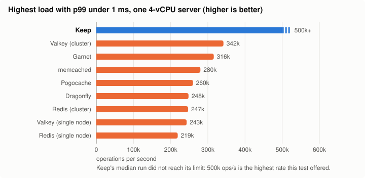
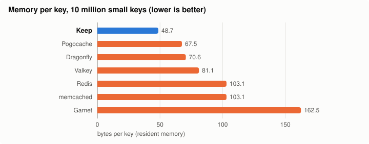

Before a mail server does anything interesting, it asks a question. Has this client exceeded its rate limit? Has this sender passed greylisting? Is another node already delivering this message? Has this mailbox changed since the cache was filled? A large cluster asks such questions more than 100,000 times a second at its peak, and while each one waits for its answer, a whole SMTP or IMAP command waits with it.

When we released [Stalwart v1.0](/blog/stalwart-1-0), we had spent months taking microseconds out of the server itself, and we chose to ship it with a stable schema and nothing to distract from that. Some of the work did not make the cut. [Encryption](/blog/encryption-gateway-post-quantum) was the first of the features to follow. This post is about one that belongs to the original performance effort: the part of a fast cluster that lives between the nodes.

Its name is [Stalwart Keep](https://github.com/stalwartlabs/keep). It is a new server, written from scratch in Rust, and from Stalwart v1.1.0 it is our recommended [in-memory store](/docs/storage/in-memory) and [coordinator](/docs/cluster/coordination/) for clusters. At the typical load of a large deployment, 99% of its requests finish within 59 microseconds, network round trip included, which leaves about 12 microseconds inside the server. And like everything in Stalwart's core, it is open source under the AGPL.

## Two services for two small jobs

A Stalwart cluster keeps its mail in shared databases and object storage, but those are the wrong place for two other things that its nodes need all the time. The first is short-lived shared state: locks, rate-limit counters, greylisting entries, tokens. The second is a way to tell each other that something has changed: a cache entry that is no longer valid, a new message that an IMAP IDLE session on another node should hear about.

The industry's usual answer is two services: Redis or Valkey for the state, and a broker such as NATS or Kafka for the messages. These are excellent pieces of software, and they offer far more than this job asks of them. Redis has rich data types and persistence. Kafka is a durable log. A mail cluster needs little of that. Its entries are short-lived, anything lost can be rebuilt, and its notifications are worthless a moment after they are sent.

That observation is where Keep begins. If nothing has to survive, the disk can go. If the data types are few, the code on the request path can be very short. If the workload is known, every structure in the server can be shaped around it. Keep does both jobs in one process, with one protocol, and the rest of its design follows from taking those freedoms seriously.

## One core, one shard, no locks

Most of the cost of a modern in-memory store is not the work itself. Looking up a key is quick. The expensive part is everything around it: system calls, threads competing for a lock, cache lines bouncing between cores, a request that arrives on one CPU and is served on another.

Keep removes the competition altogether, with a thread-per-core, share-nothing design. A server runs one shard for each CPU in its budget, and a shard is a thread that owns a slice of the keys and everything about them: the hash table, the values, their expiry, its share of the memory cap, and the connections it serves. A key's hash decides its shard, and only that shard ever touches it. Two threads never meet at the same entry, so the request path takes no locks, and a shard's data stays warm in its own CPU's cache.

Shards do read a few shared atomic values on each request, which publish the current cluster view and the member's lease. Beyond the rings that carry misrouted requests, that is all they share on the key-value path, and those values change rarely. Heartbeats and traffic between servers run on a separate control thread, so a heartbeat never queues behind a burst of requests.

Where the CPU budget is exclusive, each shard is pinned to its core. Keep reads that budget from the cpuset and the container's CPU quota, not from the number of CPUs on the host. The difference matters more than it may seem: 16 pinned shards under a 4-CPU quota were throttled in every period, with a 99th percentile above 70 milliseconds, while 4 shards under the same quota showed no such effect.

## Life of a request

The best way to see how these pieces fit is to follow a single request, a rate-limit check, from a Stalwart node to its answer.

It begins on the client. Stalwart's Keep client holds the cluster secret, so it can compute the same hash as the server. It works out which member owns the key and which shard on that member, and it writes the request to a connection it already holds to exactly that shard. No proxy stands in between, and no server has to look anything up on the client's behalf. A request that does arrive on the wrong shard still works, passed along a lock-free ring to its owner and answered on the connection it came in on, but the client normally avoids that hop.

The packet then lands on the server, and here the design reaches down to the hardware. Each shard has its own listening socket on the shared port. Where every shard is pinned and owns exactly one network receive queue, a small socket filter hands each new connection to the shard on the CPU that took it, so a connection's packets, its interrupts and its requests all stay on one core. Keep checks the machine's interrupt map at startup, and falls back to hashing, with a line in the log saying why, when the hardware does not line up.

The shard runs a plain epoll loop of its own, with no async runtime and no helper threads. In each turn it reads up to 64 KiB from every ready connection, executes everything it read, and only then writes each connection's replies with one `send`. Batching therefore grows with the load by itself: the more requests a connection delivers during a turn, the more of them share its one read and its one write. TLS follows the same rhythm, with handshakes and encryption on the shard itself, and a whole turn's replies sealed in one pass. It costs 4 to 10% of throughput.

The lookup itself is the shortest part of the journey. The hash table is laid out in cache lines, each bucket opening with a row of tag bytes, so that most non-matching entries are rejected without being read. Keys sit inline, and values of 8 bytes or less, which is what a counter needs, fit inline too. Larger values from 1 KiB up go to an arena of pre-faulted chunks, so that writing and deleting them does not pay for mapping and unmapping memory, and those regions ask the kernel for huge pages, which ease the pressure on the CPU's address translation. The whole structure costs 48.7 bytes per key at 10 million small keys, metadata included.

The reply goes back on the same connection, in the same batch as its neighbours. The node has its answer, and the SMTP command that was waiting moves on.

## Clustering without consensus

Consensus would make a request wait for other machines, so Keep does without it. It has no leader and no consensus protocol on the request path. A cluster is a fixed list of members, and every server and every client computes the same placement from that list, so a request needs one round trip to the owner and nothing more.

A key hashes to one of 16,384 slots, using the cluster secret as the hash key, and each slot belongs to the live member that a shared scoring function ranks highest for it. When a member joins or leaves, only that member's slots move. Every member sends every other member an authenticated UDP heartbeat every 25 milliseconds, and it declares a peer dead after 225 milliseconds of silence.

When a member shuts down cleanly, the members that gain its slots pull its keys over before they serve them, answering `Busy` in the meantime so that clients retry. Nothing serves a slot during the move, and a handoff that completes within its limits loses nothing that was acknowledged. A member that crashes cannot hand anything over, and its slots open empty on their new owners. Keep has no replicas, by design: for this data, a replica would be paying a permanent cost to protect something that can be rebuilt.

Cluster events ride on the same servers. A node publishes on a topic, and every subscription of that topic receives it. Events are not stored, but each subscription numbers them, and an idle one receives a heartbeat within 100 milliseconds, so a subscriber learns when an event that a server accepted for it may have been missed. Stalwart responds as it always has after a coordinator outage, by discarding its caches and checking its queues. It also publishes with confirmation, so a batch the server did not accept stays in its backlog and is tried again.

## Mutual exclusion through every failure

Speed is the easy part to demonstrate. The harder claim is about locks, because a lock in Stalwart is what stops two nodes from delivering the same message, and a store that holds everything in memory seems an unlikely place to keep such a promise. A server can crash and forget a lock while the client that holds it is still at work. If the new owner of that key then grants the lock to somebody else, two clients hold it at once.

Keep's answer is a written guarantee: under the assumptions it states about clocks and the peer network, holds of a lock by two different clients never overlap in real time, through crashes, restarts, pauses and network partitions of any shape. Three mechanisms carry it.

The first is a quarantine. After a slot changes owner without its data, Keep refuses new locks on absent keys for long enough that any earlier hold must have ended, a little over ten minutes with the defaults. It would rather answer "not yet" than answer wrongly, and the cost is one of availability, never of safety. Ordinary keys are served at once, and locks already held carry on. In a Stalwart cluster, a crashed member's share of queued messages waits up to about ten minutes longer, and then goes out. Every restart has the same cost, so a quick rolling upgrade delays new locks for about ten minutes too.

The second is self-fencing. A member that cannot confirm a majority of its list stops serving keys and locks within a second, so the minority side of a partition can never grant what the majority has taken over.

The third is time itself. Every server time in Keep reads the raw hardware clock, because NTP daemons are allowed to bend the ordinary one: chrony slews it by up to 8.3% by default, which is 0.42 seconds of a 5-second lock. Wall-clock steps and slews do not reach the server. The client counts each hold from the moment it sent the request, not from when the reply arrived, and takes off a margin for the oscillator, so neither network delay nor queueing can stretch a hold beyond what the server granted. The [full statement of the guarantees](/docs/cluster/keep/guarantees) also lists what Keep does not claim.

## Measured against the alternatives

We measured Keep against the products a cluster would otherwise use: Redis, Valkey and Dragonfly for key-value work, Redis and NATS for events, with memcached, Pogocache and Garnet as reference points. Every product ran on the same Azure servers, one at a time in a random order, across five regions, under a load modelled on what a Stalwart cluster sends: a mix of counters, locks, lookups and short-lived values, at a large deployment's typical rate of 10,100 requests per second and its peak of 122,000.

The slowest requests are the ones that hold up a mail command, so that is where we looked first. At the typical load, half of Keep's requests finish in 50 microseconds and 99% within 59, on a network whose round trip alone takes 45 to 60. On the slowest 0.1% of requests, Keep is 2.0 times faster than Valkey cluster, 2.2 times faster than Redis cluster and 3.1 times faster than Dragonfly, and at the peak load those factors grow to 2.4, 2.6 and 4.5.

On one 4-vCPU server, Keep served 500,000 requests per second, the highest rate the test offered, with 99% of them still under a millisecond in the median run. That is at least twice Redis and Dragonfly. Against Valkey cluster, the strongest competitor, we brought in more load generators to find Keep's real limit, and it came out 1.39 times ahead.

Keep also needs less to get there. It uses 1.3 to 2.6 times less CPU per request than Redis, Valkey and Dragonfly, which leaves more of the machine for everything else, and an idle server uses about 3 milliseconds of CPU per second. It also holds 10 million small keys in 48.7 bytes each, against 81.1 for Valkey and 103.1 for Redis. With the workload's own mix of key sizes, the lead narrows to 15 to 25%.

Cluster events show the same pattern as the fan-out grows. With 32 nodes all publishing and all subscribing, the slowest 1% of Keep's deliveries are 1.6 to 1.7 times faster than the next best broker, at 1.5 times less broker CPU per event, and 99% of events arrive within 169 microseconds at the lower rate tested. At 3 and 8 nodes, Keep is level with NATS on latency, at up to 1.4 times less broker CPU. Across a simulated 8-node mail cluster, replacing Redis plus NATS with Keep costs each node about 1.2 times less CPU and 1.4 times less memory.

The following chart gathers the comparisons in one place. **Across the 60 headline comparisons, Keep is better in 45, the other product in 5, 8 are about equal, and 2 are not separated by the measurement.**

Keep does not win everywhere. memcached and Pogocache are 2 to 3 times faster on the slowest 0.1% of requests on a small server, although that gap shrinks to 1.07 to 1.21 on 16 vCPUs. We measured them as reference points, because for this workload Keep does the job of Redis or Valkey together with an event broker. Single-node Valkey is level with Keep on the same measure at the typical load, although it falls far behind at the peak. Redis alone uses 1.6 times less CPU per node at 32 nodes, where every event fans out 32 times and Keep sends fewer events per network write. On ARM, Valkey's fan-out uses less CPU than Keep's in small clusters.

The conditions matter too. The key-value and event tests measure one Keep server, not a cluster of them. The latency and throughput comparisons ran without TLS, and the latency tests kept the CPU awake between requests with `idle=poll` for every product, which most deployments will not do. The load comes from a generator modelled on Stalwart's traffic, so a different mix of requests should expect different numbers. The [benchmark report](https://github.com/stalwartlabs/keep/blob/main/docs/BENCHMARK.md) has every table, the full method and the scripts to reproduce the runs.

## Breaking it on purpose

A store that hands out locks has to be right when things break, and a test on a healthy network says very little about that. So most of Keep's testing consists of breaking things deliberately, and then checking what clients saw against the written guarantees.

The foundation is about 950 unit and integration tests. Above them, a deterministic simulator runs the real cluster code on a simulated network and clock, through thousands of seeded histories and about 14,000 randomised fault schedules. A fault suite then runs real `keep` processes through about 40 cases of kills, freezes, partitions and clock faults. And over 200 deliberately injected bugs check that all of those suites catch what they should.

Then comes [Jepsen](https://jepsen.io). Jepsen is the open-source framework behind many published analyses of databases and coordination services. A control node drives clients against a cluster on separate machines, while a component called the nemesis does its best to ruin the day. Jepsen records every operation with its start and end time, then checks the entire history against a formal consistency model.

We run a five-member Keep cluster on separate VMs, through 35 runs of 5 to 15 minutes of faults each, on x86_64 and aarch64 in plaintext, and on x86_64 with mutual TLS. The nemeses kill servers with `kill -9`, freeze them with `SIGSTOP`, cut the network into majorities and minorities, cut it in one direction only, build bridges where one member sees both sides of a partition, drop and reorder packets, step and slew the clocks, and make members leave and rejoin, in combination. Through all of it, the checkers verify that reads and writes of a single key are linearizable (as if one copy of the data ran each operation in turn) while its slot stays put or moves by handoff, that reads stay valid across failovers, that increments are neither lost nor applied twice, that acknowledged writes on surviving members stay put, and, above all, that no two clients ever hold the same lock at the same time. A lock run passes only when our mutual exclusion checker, which reads the history that Jepsen records, reports `0 violations`. Keep passes all 35 runs.

To be clear about what this is: Stalwart Labs wrote this suite and runs it with the Jepsen framework. It is not an independent audit, and it is not an analysis by the Jepsen project. What we can offer instead is that these results need not be taken on trust. The workloads and scripts are public, and [the instructions to run them](/docs/cluster/keep/testing#run-jepsen) fit on one page. An Azure subscription and a few hours are enough to try to break it yourself, and we would be very interested in the results.

## Where Keep stops

Keep owes much of its speed to the things it refuses to do, so it is worth being plain about them. It is not a general replacement for Redis. It has no lists, hashes or sorted sets, no scripting and no transactions across keys, and it does not speak the Redis protocol. Nothing is written to disk, so a server that crashes loses its keys, and a cluster restarted as a whole starts empty. In a failover, reads can be stale and counters can split or restart. Clusters of up to five members have been tested, and it needs Linux 6.12 or later. Stalwart keeps supporting Redis, Valkey, NATS and Kafka, and they remain the right choice for a deployment that already runs them happily, or whose expressions and Sieve scripts store keys that have to survive a restart.

## Getting started

Keep runs as a single binary or a container, with [mutual TLS by default](/docs/cluster/keep/security) and no certificates to issue or renew. [Installation](/docs/cluster/keep/installation) covers the binaries, a systemd unit and Docker, [Cluster setup](/docs/cluster/keep/setup) takes it from a key pair to a running cluster, and [Kubernetes](/docs/cluster/keep/kubernetes) has a manifest to adapt.

Pointing Stalwart at it takes one object, and the coordinator's `Default` variant then reuses the same connection, so that a single service carries the locks, the counters and the cluster's events. [Connecting Stalwart](/docs/cluster/keep/stalwart) has the details, including how to move a running cluster from Redis. For those who enjoy this kind of thing, [Architecture](/docs/cluster/keep/architecture) and [Guarantees](/docs/cluster/keep/guarantees) go deeper than this post could, and the [source code](https://github.com/stalwartlabs/keep) is all there.

## Stay tuned

Keep is the performance story of v1.0 carried across the network: the same habit of measuring everything and removing whatever does not earn its place, applied this time to the conversation between servers. More of the features held back from the v1.0 cut are on their way, one release at a time, and all of them will be open source. Stay tuned.
