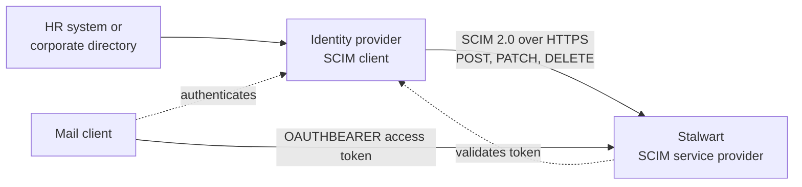

:::tip[Enterprise feature]
This feature is available in the [Enterprise edition](/docs/server/enterprise) of Stalwart.
:::

Organisations that manage their staff in a central identity provider want mail accounts to follow the life of each employee without manual work. A new hire should have a mailbox on the first day. A change of department should change the groups the employee belongs to. A departure should lock the account and, where the policy requires it, remove the mailbox. SCIM provisioning lets the identity provider carry out these changes on the mail server itself, at the moment they happen in the corporate directory.

SCIM, the System for Cross-domain Identity Management, is the standard protocol for this exchange. It defines a set of HTTP endpoints and JSON resources that represent users and groups. The identity provider acts as the SCIM client: it watches its own directory and sends a request to each application it governs whenever an identity is created, changed, suspended or deleted. The application acts as the SCIM service provider and applies each request to its own accounts. The schema is defined in [RFC 7643](https://www.rfc-editor.org/rfc/rfc7643), and the protocol in [RFC 7644](https://www.rfc-editor.org/rfc/rfc7644).

Stalwart implements the service provider side of the protocol. It receives provisioning requests at `/scim/v2` on its HTTP listeners and applies them to its accounts. It never acts as a SCIM client, so it sends no provisioning requests to other systems. SCIM requires an Enterprise license. On a server without one, requests to `/scim/v2` are refused with `403 Forbidden` and the detail `SCIM provisioning is only available in the Enterprise edition. Obtain your trial license at https://license.stalw.art/trial.`

## Roles in the deployment

A deployment with SCIM involves three parties, shown in the following diagram:

The identity provider is the SCIM client and the source of truth for identities. Examples are Microsoft Entra ID, Okta, and Keycloak with a SCIM extension. Stalwart holds the mailboxes and the data that belongs to each account.

SCIM only creates and maintains accounts. It does not verify sign-ins, so it is always combined with a directory that does. The deployment SCIM is designed for pairs it with an [OpenID Connect directory](/docs/auth/backend/oidc). In that setup, the identity provider authenticates the users, and Stalwart validates the access tokens the provider issues. SCIM creates each account before its owner signs in for the first time. SCIM also works with LDAP and SQL directories, and there it adds what those directories lack: explicit suspension and deletion of accounts ([Provisioning models](/docs/auth/scim/provisioning)).

No credential crosses the SCIM interface, because the identity provider holds the credentials. For this reason the server advertises `changePassword` as unsupported and does not publish a `password` attribute.

## SCIM for OpenID Connect domains

SCIM solves two problems that an OpenID Connect directory has on its own.

The first problem is the start of an account's life. Without SCIM, an account of an OpenID Connect directory is created the first time its owner signs in. Until then, the address does not exist on the server, so mail sent to a new employee before the first sign-in is rejected. SCIM creates the account as soon as the identity is created upstream, which is typically days before the first sign-in.

The second problem is the end of an account's life. Without SCIM, accounts are never removed. The server cannot learn that an account was deleted at the identity provider, so the mailbox of a departed employee remains and keeps receiving mail. With SCIM, the identity provider reports both events. A `PATCH` that sets `active` to `false` suspends the account and keeps its contents, and a `DELETE` removes it.

## Scope

Stalwart provisions two resource types:

- Users, which map to user accounts. A user carries its primary address, aliases, display name, locale, time zone and status.
- Groups, which map to group accounts and carry their membership.

Both resource types carry an `externalId`. This is the identifier the identity provider uses in its own records. Because `externalId` can be used in filters, a client can find a resource it provisioned earlier without storing Stalwart's identifiers.

The server also publishes the discovery endpoints that clients read when they connect: `/ServiceProviderConfig`, `/ResourceTypes` and `/Schemas`. It supports bulk operations and queries sent by POST, and it uses entity tags for optimistic concurrency, so that two clients cannot overwrite each other's changes unnoticed ([Endpoints and protocol support](/docs/auth/scim/endpoints)).

Several profiles narrow the SCIM standard for interoperability, and Stalwart follows them with one exception. It follows the [SCIM interoperability profile](https://datatracker.ietf.org/doc/draft-zollner-scim-interop-profile/) except for the profile's rule that undefined attributes must be rejected ([Undefined attributes](/docs/auth/scim/provisioning#undefined-attributes)). It implements the lifecycle requirements of the [IPSIE profile](https://datatracker.ietf.org/doc/draft-schreiber-scim-ipsie-profile/). It also supports cursor-based pagination as defined in [RFC 9865](https://www.rfc-editor.org/rfc/rfc9865).

## Setting up SCIM

On the Stalwart side, the setup consists of three decisions, described in [Configuration](/docs/auth/scim/configuration):

- Which domains the identity provider may provision. This is set by [`allowScimProvisioning`](/docs/ref/object/domain#allowscimprovisioning) on each [Domain](/docs/ref/object/domain).
- Which account the SCIM client authenticates as, and which [API key](/docs/auth/authentication/api-key) it presents as a bearer token.
- Which permissions that account holds. It needs `scimAccess`, the account management permissions, and every permission of the accounts it manages.

[Attribute mapping](/docs/auth/scim/mapping) describes how SCIM attributes are translated to account fields. [Identity providers](/docs/auth/scim/providers/) gives the procedure for individual providers.

## Diagnosing failures

When an identity provider reports a failed synchronisation, the first place to look is the server's events. Each SCIM request produces events that record what the server did:

| Event | Level | Meaning |
|---|---|---|
| `scim.request` | `debug` | A request was answered; records the method, path, status and processing time |
| `scim.forbidden` | `info` | A request was refused with 403: a missing permission, an attempt to deactivate the SCIM client's own account, a tenant or account limit, the [account modification rule](/docs/auth/authorization/permissions#granting-permissions-to-other-accounts) (`You are not authorized to grant permissions: ...`), or no Enterprise license |
| `scim.conflict` | `info` | A request was refused with 409 or 412: a duplicate `userName`, `externalId` or group name, or a stale entity tag |
| `scim.error` | `debug` | Any other error response, with the status, `scimType` and detail |
| `scim.resource-created`, `scim.resource-updated`, `scim.resource-deleted` | `info` | A user or group was created, changed or deleted |
| `scim.query` | `debug` | A list or search request was evaluated |
| `scim.attribute-ignored` | `debug` | A `PATCH` operation targeted an attribute that is accepted but not stored |
| `scim.bulk-processed` | `debug` | A bulk request was processed |
| `scim.bulk-aborted` | `warn` | A bulk request stopped after reaching its `failOnErrors` limit |
| `scim.rollback-failed` | `error` | A change that failed part-way could not be fully undone, so the group and its members need checking |

The status code that the identity provider logs leads to the matching event. A `403` response corresponds to a `scim.forbidden` event, a `409` to `scim.conflict`, and a `400` to `scim.error`. Each event carries the same detail that was returned to the client. The [event reference](/docs/ref/events) gives the fields of each event.
