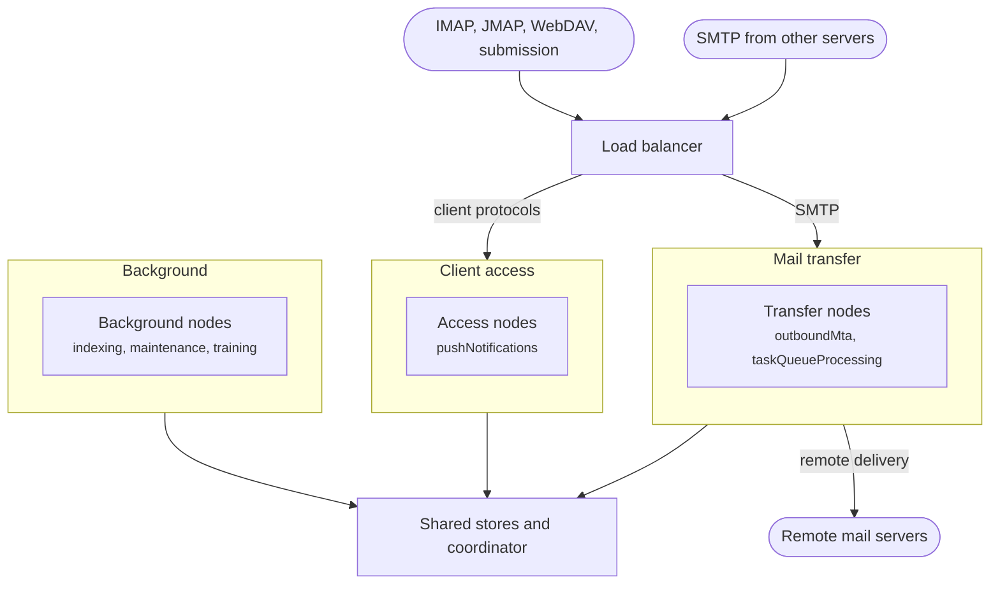
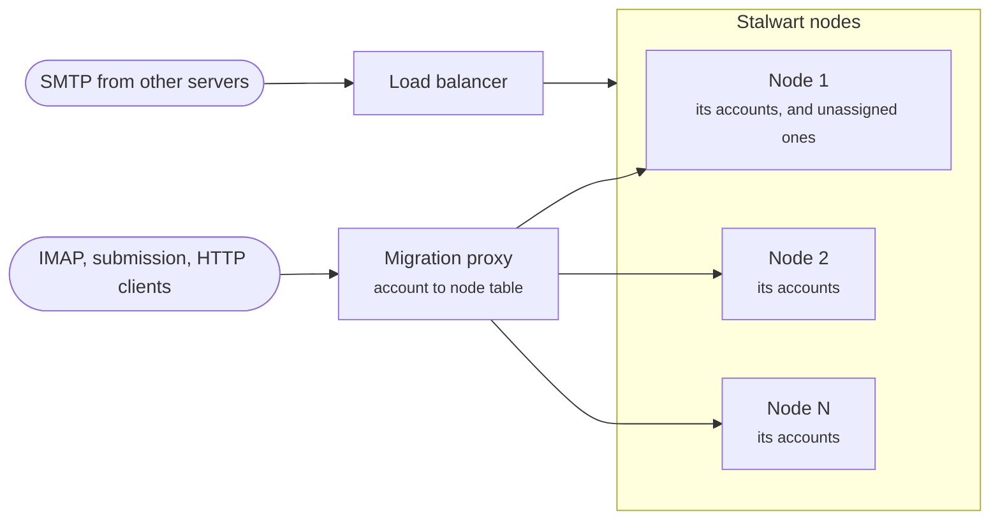
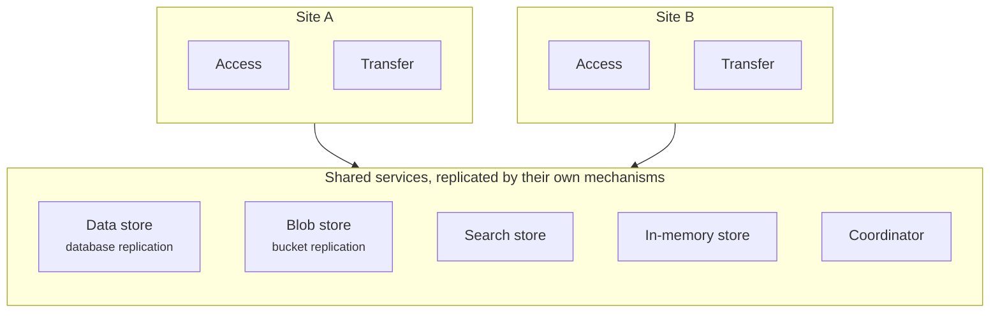

Every node of a Stalwart cluster can serve every account over every protocol, because the nodes keep no data of their own apart from caches. The topology of a cluster is therefore not a question of correctness. It decides how the work is spread across machines: which [network listeners](/docs/server/listener) each node opens, which background tasks it runs, how the load balancer distributes connections, and where the nodes stand in relation to the shared stores. A [cluster role](/docs/cluster/configuration/roles) selects the listeners and tasks of a node, and the load balancer, or a proxy in front of the nodes, does the rest.

The layouts on this page start with the simplest and become more specialised. They can be combined, and a cluster can move from one to another at any time: a node takes a new role when it restarts, and no data has to move.

## Identical nodes

The simplest cluster has no roles. Every node opens every listener and runs every background task, every node can replace any other, and the load balancer distributes connections without session affinity, as described in [Load balancing](/docs/cluster/configuration/load-balancing). The [cluster overview](/docs/cluster/) shows this layout.

Two nodes are the minimum for the service to survive the loss of one. Three nodes allow one node to be taken down for maintenance while the cluster can still tolerate the failure of another. Stalwart nodes form no quorum, so any number of nodes works, and [Sizing](/docs/cluster/deployment/sizing) explains how to find the right number.

Identical nodes have one cost that grows with the cluster. Each node that runs the `taskScheduler` task queues its own copy of every periodic task, so the daily purges run once per node, and every node with `spamClassifierTraining` trains the classifier. Beyond a few nodes, a role that removes these two tasks from all but one node avoids the repeated work while the cluster otherwise stays uniform.

## Groups by kind of work

As a cluster grows, its work divides naturally into three kinds: serving clients, transferring mail, and background processing. Placing each kind on its own group of nodes lets each group be sized for its own load, and keeps CPU-intensive tasks such as search indexing and classifier training away from the nodes that answer clients. [Planning node roles](/docs/cluster/configuration/roles#planning-node-roles) lists the listeners and tasks of each group and gives the role definitions.

The following diagram shows the three groups behind a load balancer:

The transfer group does more than send mail to other servers. Every message in the queue, whatever its destination, is delivered by a node with the `outboundMta` task, and that includes delivery to local mailboxes. A message accepted by any node, including one submitted over JMAP or SMTP submission on an access node, is therefore written to its recipients' mailboxes by a transfer node, which also runs their Sieve scripts at that moment. The transfer group must be sized for local delivery as well as for remote traffic, and a cluster in which no node has `outboundMta` accepts mail but never delivers it.

Nodes that accept messages but do not run `outboundMta` rely on the [coordinator](/docs/cluster/coordination/) to tell the transfer nodes that new messages are waiting. Without a coordinator, a transfer node finds those messages only at its next periodic scan of the queue, which delays delivery.

Outgoing connections leave from the address of the transfer node that makes them, unless a [connection strategy](/docs/mta/outbound/connection) selects a local address. The SPF records and reverse DNS of the sending domains must therefore cover the addresses of every node in the transfer group, and of any node added to it later.

Every group keeps the plain HTTP listener. Health checks use it, and so does Prometheus when it scrapes the metrics of each node, so a role that omits it fails every health check. On the background group, `taskScheduler` and `spamClassifierTraining` belong on a single node for the reasons given under identical nodes; the other background tasks can run on several nodes for redundancy, since their work items are locked so that each one is processed once.

A cluster of three nodes can use the same idea at a smaller scale: two nodes serve clients and transfer mail, and the background tasks run on one of them.

## Separate client protocols

The client access group can itself be divided by protocol. IMAP, POP3 and ManageSieve each have their own listeners, so a role can open them on one group of nodes while another group opens only the HTTP listeners. The reason to do so is the different shape of the load. IMAP clients hold long-lived sessions, and each session in IDLE keeps state in the node's memory while it waits, whereas most HTTP requests are short. Separating them lets each group be sized for its own pattern, and a surge of IMAP connections no longer competes with JMAP and WebDAV requests.

The division stops at the HTTP listener. JMAP, CalDAV, CardDAV and WebDAV file storage, the WebUI, the OAuth endpoints and autoconfiguration are all served by the same HTTP listener, so roles cannot place them on different nodes. A load balancer that routes HTTP requests by path can still send them to different groups, but Stalwart itself does not distinguish them. SMTP submission is a listener of its own and can be placed with either group.

The IMAP group keeps the plain HTTP listener for health checks, like every other group.

## Account affinity

Each node caches the data of the accounts it serves. When connections are distributed without affinity, an active account is eventually cached on every node that has served it, and the cluster holds several copies of the same data. Routing all the connections of an account to the same node keeps one copy, which lowers the memory needed per node and keeps the cache of each account warm, as [Tuning a cluster](/docs/performance/cluster) explains.

A Stalwart cluster needs no proxy, but the [migration proxy](/docs/migration/proxy/) can be placed in front of it as a permanent router that provides this affinity. [Cluster routing](/docs/migration/proxy/examples/cluster) describes the configuration. The following diagram shows the arrangement:

The proxy reads the account from the credentials of each connection and looks it up in a table that assigns accounts to nodes. The table is filled by whatever provisions the accounts, and accounts can be rebalanced by changing it. An account without an entry, and a request without credentials, goes to the single default destination, so new accounts should receive an entry when they are created.

This affinity costs some availability. The proxy does not move an account to another node when its node fails: connections for the accounts of that node fail until the operator assigns them elsewhere, clears the proxy's cache and ends the open sessions, as the cluster example describes. Inbound SMTP from other servers carries no credentials, so it cannot be routed by account; it reaches the nodes through the load balancer as before.

A shared [cache swap](/docs/storage/cache-swap) tier addresses the same cost from the other side. Without changing how connections are distributed, it lets a node load the snapshot of a large account written by another node instead of rebuilding it from the data store. A tier in Keep or Redis needs memory for every snapshot written within the retention period, as [Memory for in-memory snapshots](/docs/storage/cache-swap#memory-for-in-memory-snapshots) explains, and a deployment that cannot provide it combines account affinity with the `LocalFile` tier, or uses the blob store.

## Several sites

Stalwart has no notion of a site or a region. A deployment across several data centres repeats the same groups of nodes in each site, and every node, wherever it runs, uses the same logical data store, blob store, search store, in-memory store and coordinator. The following diagram shows two sites:

Replication between sites is the responsibility of these services, not of Stalwart. Stalwart writes each blob to one blob store, so copies in other sites come from the storage service, for example by bucket replication. The data store is replicated by the database: FoundationDB has its own multi-data-centre support, which uses the `datacenterId` and `machineId` locality options described in [FoundationDB](/docs/storage/backends/foundationdb), and PostgreSQL and MySQL use their replication features. [Cluster storage](/docs/cluster/deployment/storage) gives the requirements of each store.

SQL [read replicas](/docs/storage/backends/composite#sql-read-replicas) (Enterprise) spread read queries across replica databases, but Stalwart uses the replicas in turn and does not prefer one near the node. They reduce the load on the primary without keeping reads within a site, and writes always go to the primary.

The distance between a node and the shared services matters. The in-memory store is consulted while serving requests, for example for rate limits and failed sign-in counters during authentication and for greylisting during SMTP RCPT TO, and the data store is read on every cache miss and written on every change. The round-trip time from a node to these services therefore adds to the latency of the requests it serves.

Node identifiers are shared by all sites. Every node needs a hostname that is unique across the whole deployment, and the cluster as a whole is limited to 512 nodes, as described in [Node identifiers](/docs/cluster/configuration/node-id). When the link to the coordinator is lost, the nodes in a site continue to serve their clients, with the delays described in [Coordinator outages](/docs/cluster/coordination/#coordinator-outages).

## Orchestrated deployments

Orchestrators apply the same layouts, with one constraint: a role is set by the `STALWART_ROLE` environment variable, and all the replicas of one workload share the same environment. Each group of nodes is therefore its own workload. On Kubernetes, each group is a separate StatefulSet, installed as its own Helm release, as described in [Kubernetes](/docs/cluster/orchestration/kubernetes). On Docker Swarm, each group is a separate service, as described in [Docker Swarm](/docs/cluster/orchestration/docker-swarm). The roles must exist before a workload refers to them.
