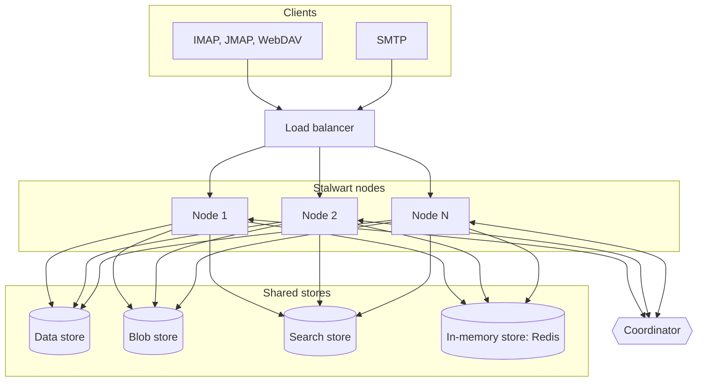

A single mail server is a single point of failure, and a Stalwart cluster removes it. It is a group of servers that share the same data and serve the same domains and accounts, so any node can serve any account over any protocol. Clients and sending servers can therefore be distributed among the nodes, by a load balancer or by DNS, and the service continues when a node fails.

The outbound mail queue is shared as well. Every node with the `outboundMta` task delivers queued messages, so a message queued on a node that fails is delivered by another.

The design rests on one principle: nodes hold no data of their own, apart from caches. Everything that must survive the loss of a node is kept in stores that all nodes share. Stalwart therefore does not route connections to a particular node, and it does not keep an account on one node. A cluster has at most 512 nodes, which is the number of available [node identifiers](/docs/cluster/configuration/node-id).

The following diagram shows the parts of a cluster: clients reach the nodes through a load balancer, the nodes share their stores, and a coordinator connects them:

## Building blocks

Four concepts underlie every cluster. Each of them is described in detail on its own page.

### Shared stores

All nodes use the same [data store](/docs/storage/data), [blob store](/docs/storage/blob), [search store](/docs/storage/fts) and [in-memory store](/docs/storage/in-memory). A change made through any node, such as a delivered message or a new account, is therefore visible to all the others. [Cluster storage](/docs/cluster/deployment/storage) describes the requirements for each store.

### Node identifiers

Records created at the same moment on different nodes must not receive the same identifier. To guarantee this, each node obtains a unique [node identifier](/docs/cluster/configuration/node-id) from the data store when it starts, based on its hostname, and embeds it in the identifiers it generates for new records.

### Roles

Not every node has to do everything. A [cluster role](/docs/cluster/configuration/roles) selects the network listeners and the background tasks that a node runs, such as outbound delivery, search indexing or store maintenance. A node without a role runs everything. With roles, a group of nodes can, for example, serve IMAP and JMAP clients while another group receives and delivers mail.

### Coordinator

Each node keeps caches of account data, configuration and security state in memory, and these caches go out of date when another node changes the data behind them. The [coordinator](/docs/cluster/coordination/) is a messaging service, such as NATS or Redis, through which the nodes tell each other about such changes. A message on the coordinator can announce a cache entry that is no longer valid, or a configuration change. It can announce a new message that IMAP IDLE sessions or push subscriptions on another node must be told about, or an IP address that has been blocked.

Without a coordinator, none of this information travels. The other nodes keep cached entries until they are evicted, and they apply configuration changes only when they are reloaded or restarted. They also never pass on the notifications of messages delivered by another node.

## Cluster requirements

A cluster requires the following components, each described on the linked page:

- A shared data store: [PostgreSQL](/docs/storage/backends/postgresql), [MySQL or MariaDB](/docs/storage/backends/mysql), or [FoundationDB](/docs/storage/backends/foundationdb). RocksDB and SQLite are embedded databases that only one process can open, so a cluster cannot use them.
- The same DataStore definition in the `config.json` of every node. The data store setting is the only one kept per node, as described in [Data store](/docs/storage/data#datastore-and-configjson).
- A shared blob store: [S3-compatible](/docs/storage/backends/s3) storage, [Azure Blob Storage](/docs/storage/backends/azure), a separate database, or the shared data store (the `Default` variant).
- A shared search store: the shared data store (`Default`), a separate PostgreSQL, MySQL or FoundationDB database, [ElasticSearch](/docs/storage/backends/elasticsearch) or [Meilisearch](/docs/storage/backends/meilisearch).
- A [Redis-based in-memory store](/docs/storage/backends/redis): Redis, Valkey, Redis Cluster, Redis Sentinel, or a sharded store of Redis servers (Enterprise). The local in-memory store of a single-node installation is refused when a coordinator is configured.
- A [coordinator](/docs/cluster/configuration/coordination). The official binaries support NATS and Redis, and the Redis coordinator can reuse the in-memory store's connection.
- A unique hostname per node, or a unique `STALWART_HOSTNAME`, from which the [node identifier](/docs/cluster/configuration/node-id) is derived.
- Optionally, a shared [cache swap](/docs/storage/cache-swap) tier in Redis or the blob store, so that an account served by a different node after a restart does not have to be rebuilt from the data store.

Two of these components depend on each other: the in-memory store must be configured before the coordinator. [Coordination mechanism](/docs/cluster/configuration/coordination#order-of-configuration) describes the order of configuration, and the errors returned when it is not followed.

Once these components are in place, the cluster can grow at any time. A new node joins by starting with the same `config.json` as the others.

## Further reading

The rest of this section, and a few related pages, cover each part in depth:

- [Cluster configuration](/docs/cluster/configuration/) covers node identifiers, the coordinator, load balancing and roles.
- [Deployment](/docs/cluster/deployment/) covers storage choices and sizing.
- [Orchestration](/docs/cluster/orchestration/) covers Kubernetes and Docker Swarm.
- [Tuning a cluster](/docs/performance/cluster) covers performance.
- The [proxy cluster routing example](/docs/migration/proxy/examples/cluster) places the migration proxy in front of a cluster as a permanent router that assigns each account to one node, so that the node's caches for the account stay warm.
