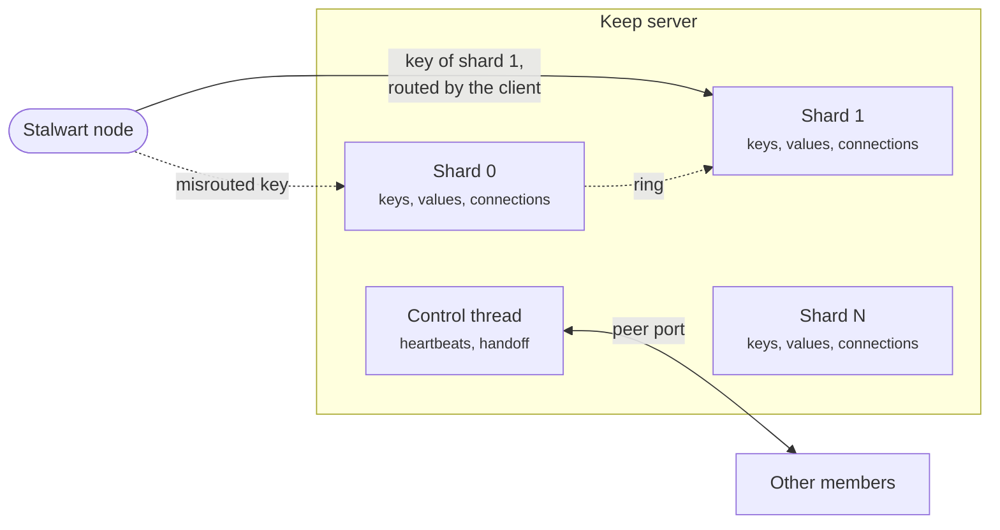

Keep's performance comes from a few design choices that are unusual together. The server is thread-per-core and share-nothing, so requests take no locks. A cluster has no leader and no consensus round, so a request never waits for other servers. It stores no data on disk, so nothing on the request path waits for I/O either. This page explains how those choices work, starting with one server.

## Thread-per-core shards

A Keep server is one process with one shard for each CPU in its budget. A shard is a thread that owns a part of the keys and everything about them: the hash table, the values, their expiry, its share of the memory cap, and the connections it serves. A key's shard is computed from a hash of the key.

Shards share no key data, which is what share-nothing means here. Two threads never compete for the same entry, so the request path takes no locks, and a shard's data stays in its own CPU's cache. Shards do read a few shared atomic values on each request, which publish the current cluster view and the member's lease. Those are read-mostly, and they are the only shared state on the steady-state request path.

Shards are pinned to their CPUs when the CPU budget is exclusive. A separate control thread, not pinned, handles the peer port and heartbeats, so cluster traffic never runs on a shard.

The following diagram shows how a request reaches its shard:

## Event loop and batching

Each shard runs its own event loop over a level-triggered epoll instance, with no async runtime and no helper threads. TLS handshakes and encryption run on the shard too.

In each turn, a shard reads up to 64 KiB from every ready connection, executes everything it read, and only then writes each connection's replies with one `send`. A busy connection therefore costs few system calls per request, and the batching grows naturally with load: the more requests arrive during a turn, the more share each system call. Under TLS, replies are sealed in one pass in records of up to 16 KiB.

The protocol is a small binary frame format with request ids, so a client can pipeline requests and receive replies out of order. An overloaded or moving server answers `Busy` rather than queueing without limit, and a server that does not own a key answers `Moved`.

## Connection steering

All shards serve one port, each with its own listening socket, through `SO_REUSEPORT`. Keep's goal is for a connection's packets, its interrupts and its requests to stay on one core.

Where every shard is pinned and owns exactly one network receive queue, Keep attaches a small socket filter that hands each new connection to the shard on the CPU that took it. This is CPU steering. Elsewhere, the kernel spreads connections by hash. [NIC queues and IRQ affinity](/docs/cluster/keep/tuning#nic-queues-and-irq-affinity) covers how to arrange for the former.

## Cross-shard forwarding

Every connection accepts every key. A request that arrives on the wrong shard is forwarded to the owner over a single-producer, single-consumer ring, and answered on the connection it came in on. Forwarded requests travel in batches, and a shard is woken only if it is parked.

The client normally avoids this hop altogether. It knows the cluster secret, so it computes the same hash, opens connections to each shard, and sends each request straight to the owner. This is why setting the [`secret`](/docs/cluster/keep/stalwart#connection-settings) in Stalwart improves performance.

## Hash table and value arena

The hash table is an open-addressing table laid out in cache lines. Each bucket carries a header of tag bytes, so a lookup can reject most entries without reading them, and keys are stored inline. It costs about 49 bytes per key at 10 million small keys, metadata included.

Small values live on the heap, and values of 8 bytes or less fit inline. Values from 1 KiB go to a value arena: chunks of at least 2 MiB, in size classes, with a warm spare chunk kept pre-faulted. Large writes and deletes therefore do not pay for mapping and unmapping memory. Keep requests huge pages for these regions, which reduces TLB misses, as [Huge pages](/docs/cluster/keep/tuning#huge-pages) describes.

Each key belongs to a key class, chosen by its first byte. Each class has its own eviction rule under the memory cap, and lock keys are in pinned classes that are never evicted.

## Membership and placement

A cluster is a fixed list of members, with no leader and no consensus protocol. Every server and every client computes the same placement from the same list, so a request needs only one round trip to the owner. There is nothing else to wait for.

A key hashes, with the cluster secret as the hash key, to one of 16,384 slots. Each slot belongs to the live member with the highest rendezvous score for it, so when a member joins or leaves, only that member's slots move. Clients fetch the topology from the members, follow the view a majority reports, and route each request accordingly.

Every member sends every other member an authenticated UDP heartbeat every 25 milliseconds, and it declares a member dead after 225 milliseconds of silence. A member that cannot hear a majority of the list fences itself, so the minority side of a partition never serves locks that it may have lost.

## Handoff

When a member leaves, the members that gain its slots pull its keys, locks included, over the TCP peer port, and answer `Busy` for those slots until they have them. Nothing serves a slot in between, so no acknowledged write is lost in a clean move. A member that dies cannot hand anything over, so its slots open empty on their new owners, under the [lock quarantine](/docs/cluster/keep/operations#lock-quarantine).

## Cluster event delivery

A publish reaches every subscription of its topic on the server it was sent to, across all its shards. Members do not forward events to each other, so cluster-wide delivery is a matter for the client: it either subscribes on every member, or publishes and subscribes on one member. Each subscription numbers its events, and an idle subscription gets a heartbeat every 100 milliseconds, so a gap is reported as possible loss within that time.

## Performance compared with alternatives

These design choices are why Keep is the recommended store for Stalwart clusters. Keep was measured against Redis, Valkey and Dragonfly for key-value work, and against Redis and NATS for cluster events, on the same cloud servers and network. The workload was modelled on a Stalwart cluster: a mix of counters, locks, lookups and short-lived values, at a large deployment's typical rate of 10,100 requests per second and its peak of 122,000. The latency and throughput tests ran without TLS, and the latency tests kept the CPU awake between requests with `idle=poll` for every product, a setting most deployments will not use.

The results were as follows:

- **Latency.** At the typical load, 99% of Keep's requests finish within 59 microseconds, round trip included. On the slowest 0.1% of requests, Keep is 2.0 times faster than Valkey cluster, 2.2 times faster than Redis cluster and 3.1 times faster than Dragonfly. At the peak load, those factors are 2.4, 2.6 and 4.5.
- **Throughput.** On one 4-vCPU server, Keep keeps 99% of requests under 1 millisecond up to at least 500,000 requests per second. That is 1.39 times Valkey cluster, the next best, and at least twice Redis and Dragonfly.
- **Efficiency.** Keep uses 1.3 to 2.6 times less CPU per request than Redis, Valkey and Dragonfly, and 1.4 to 2.1 times less memory per key on 10 million small keys. With the workload's mix of key sizes, it uses 15 to 25% less memory per key.
- **Whole cluster.** With Keep in place of Redis plus NATS, each simulated Stalwart node uses about 1.2 times less CPU and 1.4 times less memory at 8 nodes.

The choice also has costs, and Keep does not win everywhere. Single-node Valkey is about level with Keep on the slowest 0.1% of requests at the typical load, and single-node Redis is not separated from it at the peak. Both give up the scaling of a cluster to get there. Redis replicas and persistence provide durability that Keep does not attempt: a crashed Keep member loses its keys. At 32 nodes, Redis alone uses 1.6 times less CPU than Keep, although Keep still uses less than Redis plus NATS. Workloads with a different mix of requests should expect different numbers.

The complete results and methods are in the [benchmark report](https://github.com/stalwartlabs/keep/blob/main/docs/BENCHMARK.md).
