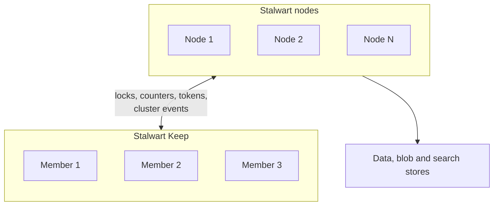

The nodes of a Stalwart cluster keep their mail in shared databases and object storage, but they also need two things that a database serves poorly. They need a fast place for short-lived state, such as the lock that stops two nodes from delivering the same message, and they need a way to tell each other that something has changed. These jobs commonly take two services: Redis or Valkey for the state, and a broker such as NATS or Kafka for the messages.

Stalwart Keep does both jobs in one server, with one protocol. It is the recommended [in-memory store](/docs/storage/in-memory) and [coordinator](/docs/cluster/coordination/) for Stalwart clusters, and it can also hold the snapshots of [cache swapping](/docs/storage/cache-swap). Keep is a separate program, written in Rust, which normally runs on its own servers. The Stalwart nodes connect to it as clients.

A group of Keep servers is called a Keep cluster, and each server in it is a member. These pages use "node" only for the Stalwart nodes that connect to Keep.

The following diagram shows where Keep sits in a Stalwart cluster:

## Ephemeral state

Keep is a key-value store whose contents are expected to disappear. Every entry lives in memory and nothing is written to disk, so a restarted server starts empty. Keys can carry an expiry, values can be counters, and a memory cap makes room by evicting the entries that matter least. Locks are never evicted.

This suits what Stalwart keeps in its in-memory store: rate-limit counters, greylisting entries, locks and short-lived tokens. All of these are either short-lived or can be rebuilt, so losing them costs a retry or a repeated check, not mail.

Each key lives on exactly one member, and there are no replicas. A member that shuts down cleanly hands its keys to the members that take over from it. A member that crashes loses its keys, and the other members take over its share of the keys with no data for them.

## Locks

A lock must remain correct while servers crash and networks fail, and losing a lock's record must not let a second holder in while the first is still working. Keep therefore holds a mutual exclusion guarantee through crashes, restarts, pauses and network partitions. It pays for this with a period called the lock quarantine: after a member loses its keys, new locks on those keys are refused for about ten minutes, because the last holder of an unknown lock may still be working. [Lock quarantine](/docs/cluster/keep/operations#lock-quarantine) describes the effect on a running cluster, and [Guarantees](/docs/cluster/keep/guarantees) states exactly what is promised.

## Cluster events

Keep also carries the notifications that Stalwart nodes exchange through their coordinator: cache invalidations, configuration changes and new mail signals. A node publishes an event on a topic, and every subscriber of that topic receives it.

Events are not stored. A subscriber sees only what is published while it is connected, but it does learn when events may have been missed, because each subscription numbers its events. Stalwart responds to such a report by discarding its caches and checking its queues, as described in [Coordinator outages](/docs/cluster/coordination/#coordinator-outages).

## Role in a Stalwart cluster

Stalwart can use Keep for three purposes, which can be adopted separately:

- As the in-memory store, for counters, greylisting entries, locks and tokens.
- As the coordinator, for cluster events. The coordinator's `Default` variant reuses the in-memory store's connection, so a cluster that uses Keep for both needs no further service.
- As the cache swap store, for snapshots of account caches. The snapshots can need far more memory than the other two uses, as described in [Memory for in-memory snapshots](/docs/storage/cache-swap#memory-for-in-memory-snapshots).

[Connecting Stalwart](/docs/cluster/keep/stalwart) gives the configuration for each purpose.

## Recommended use

Keep is the recommended choice for a new Stalwart cluster. It replaces two services with one, and in most comparisons on this workload it is faster and uses less CPU and memory than the alternatives. [Performance compared with alternatives](/docs/cluster/keep/architecture#performance-compared-with-alternatives) gives the figures, along with the cases in which Keep does not come out ahead.

Redis or Valkey, with NATS where a separate coordinator is wanted, remains the better choice in the following situations:

- Keys written by expressions and Sieve scripts have to survive a restart. Keep has no persistence, while [Redis](/docs/storage/backends/redis) can write its data to disk.
- The servers cannot run Linux kernel 6.12 or later, which Keep requires.
- The deployment already runs Redis or NATS and has no problem to solve by replacing them.
- The in-memory store has to be a [sharded store](/docs/storage/backends/composite#sharded-in-memory-store), which cannot have Keep as a member.

## Limits

Keep is deliberately narrow, and the following limits apply to any deployment:

- Keep is not a general replacement for Redis. It has no lists, hashes, sets or sorted sets, no scripting and no atomic operations across keys, and it does not speak the Redis protocol.
- A Keep cluster that restarts as a whole starts empty.
- Keys are at most 255 bytes and values at most 4 MiB, and expiry times are whole seconds.
- Member addresses are fixed IP addresses. There is no name resolution, and the member list is set in the configuration of every member.
- Clusters of up to five members have been tested. The protocol allows 4,096 members, but larger clusters are untested.
- Event delivery is fan-out only: every subscription of a topic receives every event, and members do not forward events to each other.

The source code, the wire protocol specification and the Rust client are in the [Keep repository](https://github.com/stalwartlabs/keep).
