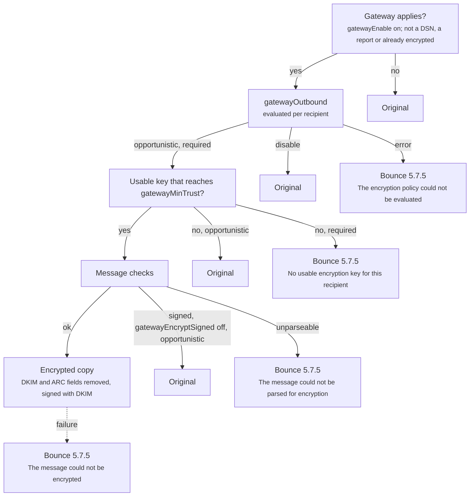

Many organisations must not send readable mail to some of their correspondents, yet few of their users have a mail client set up for OpenPGP or S/MIME, and fewer still use it consistently. An encryption gateway solves this at the server. When a message leaves for a recipient whose public key the server knows, the gateway encrypts it with that key on the way out. The sender does nothing different, and the recipient reads the message in their own mail client with their own private key, exactly as if the sender had encrypted it.

The message then stays encrypted on every server it passes through, including the recipient's provider, which TLS alone cannot achieve. The gateway works on outgoing mail only: it encrypts and never decrypts, and since it holds no private keys it does not sign messages with OpenPGP or S/MIME either. Incoming mail for local users is protected by [encryption at rest](/docs/encryption/at-rest) instead.

The gateway needs to know each recipient's public key in advance. These keys are [external keys](/docs/encryption/external-keys): an administrator enters them, the server keeps them up to date from a source such as the recipient domain's key directory, or the server [learns them](/docs/encryption/harvesting) from signed mail that the recipients send. The gateway never searches for the key of an unknown recipient while sending.

## Process

The gateway acts when a message is accepted into the queue, before the server confirms the acceptance to the sending client. This covers every queued message, not only those that local users send: mail that an alias, a mailing list or a Sieve redirect forwards to an outside address, and mail relayed for other hosts, is encrypted in the same way. For each recipient, it takes four steps:

1. It evaluates the outbound policy, which decides whether the recipient's copy must be encrypted, may be encrypted, or is left alone.
2. It looks up the recipient's external key and checks that the key is usable and trusted enough.
3. When a key is found, it encrypts a separate copy of the message for that recipient and signs the copy with DKIM.
4. When no key is found and encryption is required, it marks the recipient as failed, so the sender receives a bounce.

The original message and the encrypted copies are then queued together, and delivery sends each recipient its own copy. Recipients without a key receive the original.

The following diagram shows how the gateway decides what each recipient receives:



## Enable the gateway

The gateway is configured in the [Encryption](/docs/ref/object/encryption) singleton, found in the WebUI under <!-- breadcrumb:Encryption/EncryptionGateway --><svg class="lucide-icon" width="1em" height="1em" xmlns="http://www.w3.org/2000/svg" viewBox="0 0 24 24" fill="none" stroke="currentColor" stroke-width="2" stroke-linecap="round" stroke-linejoin="round" ><path d="M10 5H3" /><path d="M12 19H3" /><path d="M14 3v4" /><path d="M16 17v4" /><path d="M21 12h-9" /><path d="M21 19h-5" /><path d="M21 5h-7" /><path d="M8 10v4" /><path d="M8 12H3" /></svg> Settings › <svg class="lucide-icon" width="1em" height="1em" xmlns="http://www.w3.org/2000/svg" viewBox="0 0 24 24" fill="none" stroke="currentColor" stroke-width="2" stroke-linecap="round" stroke-linejoin="round" ><circle cx="12" cy="16" r="1" /><rect x="3" y="10" width="18" height="12" rx="2" /><path d="M7 10V7a5 5 0 0 1 10 0v3" /></svg> Encryption › Gateway<!-- /breadcrumb:Encryption/EncryptionGateway -->. Its [`gatewayEnable`](/docs/ref/object/encryption#gatewayenable) field is <!-- default:Encryption.gatewayEnable as=enabled -->disabled<!-- /default --> by default. While it is disabled, outgoing mail is not touched, external keys are ignored, no keys are learned from incoming mail and the key maintenance task does nothing. A policy that returns `disable` for every recipient stops the encryption of outgoing mail, but harvesting and key refreshes continue.

## Outbound policy

The [`gatewayOutbound`](/docs/ref/object/encryption#gatewayoutbound) field decides what happens to each recipient of each message. It is an [expression](/docs/configuration/expressions/), evaluated once per recipient with the [queue variables](/docs/configuration/variables#queue-variables), such as `rcpt`, `rcpt_domain`, `sender` and `sender_domain`, and it returns one of three modes:

- `disable` leaves the recipient alone: the recipient receives the original message, and no key is looked up.
- `opportunistic` encrypts when the recipient has a usable key, and otherwise sends the original in plain text.
- `required` encrypts when the recipient has a usable key, and otherwise rejects the recipient, so the sender gets a bounce instead of a plain-text delivery.

The default policy, shown in the [field reference](/docs/ref/object/encryption#gatewayoutbound), disables the gateway for recipients in local domains and is opportunistic for all others.

Opportunistic mode suits most deployments: every recipient with a known key gets encrypted mail, and nobody loses mail for lack of a key. Required mode is for recipients that must never receive plain text, typically a partner organisation with a contractual obligation, and is best limited to them. The following policy requires encryption for one partner domain, leaves local recipients alone and stays opportunistic for everyone else:

```json
{
  "gatewayOutbound": {
    "match": {
      "0": {"if": "is_local_domain(rcpt_domain)", "then": "disable"},
      "1": {"if": "rcpt_domain == 'partner.example.com'", "then": "required"}
    },
    "else": "opportunistic"
  }
}
```

The expression alone decides the mode; the queue route plays no part. A constant `required` therefore also applies to local recipients, who have no external key, and every message to them would bounce. A policy should always exclude local domains as the default does. Conditions can also depend on the sender, through `sender` and `sender_domain`, for example to require encryption only for mail from one department's domain.

### Policy validation

The server checks the expression when the setting is saved, and rejects an expression that does not compile or that has an empty `else` branch, with an error such as `Property 'else' is required` or `Invalid value 'Error parsing 'if' expression in condition #1: <error>' for property 'gatewayOutbound'`. The save check covers the syntax, the variables and the constants; it cannot check what a condition returns at run time.

Two conditions are handled at startup, for a configuration that reached the store without that check:

- An empty policy is reported with `Empty outbound policy: recipients are rejected until it is fixed`, and it rejects every recipient, so that a damaged policy never sends mail in plain text.
- A policy that does not compile is reported with its compile error, and the default policy applies in its place.

A configuration reload that finds either problem is not applied at all, so the previous configuration keeps running until the error is fixed.

At run time, a recipient for whom the policy, or the minimum trust described below, cannot be evaluated, or returns something other than a mode, is rejected even in opportunistic mode. The bounce says `The encryption policy could not be evaluated`.

## Key selection

The gateway looks up the recipient's address, in lower case, among the [external keys](/docs/encryption/external-keys). Each address has at most one external key, and there are no keys for whole domains, wildcards or address variants. A key is usable when all of the following hold:

- The key record is not disabled. A record whose replacement key is awaiting approval keeps using its current key.
- The record holds a key, and the key is still valid: not expired, not revoked and parseable.
- Its kind, OpenPGP or S/MIME, is listed in [`gatewayMethods`](/docs/ref/object/encryption#gatewaymethods). Removing a kind from the list stops the gateway from using any key of that kind, and from fetching new keys of that kind.
- Its trust level reaches the minimum set by [`gatewayMinTrust`](/docs/ref/object/encryption#gatewaymintrust).

A key that fails any of these counts as no key, and the recipient's mode decides what happens next.

### Minimum trust

Not every key deserves the same confidence. A key that an administrator entered is certain; a key that anyone could have uploaded to a public key server is not, and encrypting to an attacker's key would hand the message to the attacker. Every external key therefore carries a [trust level](/docs/encryption/external-keys#trust-levels), from `manual`, the highest, through `verified`, `discovered` and `harvested`, to `unverified`.

`gatewayMinTrust` is an expression evaluated per recipient, with the same variables as the policy, that returns the lowest trust level the gateway accepts. The default, <!-- default:Encryption.gatewayMinTrust -->`harvested`<!-- /default -->, accepts every key except `unverified` ones: keys from public HKP key servers, Autocrypt keys whose message signature could not be checked and S/MIME certificates without a valid chain. The following setting accepts only administrator-entered and verified keys for one partner domain, and the default minimum elsewhere:

```json
{
  "gatewayMinTrust": {
    "match": {"0": {"if": "rcpt_domain == 'partner.example.com'", "then": "verified"}},
    "else": "harvested"
  }
}
```

### Key cache

The gateway caches the key records it has looked up, up to the size set by [`externalPublicKeys`](/docs/ref/object/cache#externalpublickeys) in the [Cache](/docs/ref/object/cache) settings, for [`keyRefreshInterval`](/docs/ref/object/encryption#keyrefreshinterval). An address without a key record is also remembered, for [`negativeCacheTtl`](/docs/ref/object/encryption#negativecachettl), so that mail to it costs no store lookup. Creating, changing or deleting a key record clears the cached entry for its address on every node of a cluster, so changes take effect for the next message.

## Algorithms

The algorithms come from the recipient's key, as they do for encryption at rest; the [OpenPGP](/docs/encryption/pgp) and [S/MIME](/docs/encryption/smime) pages describe the rules. For S/MIME, the gateway uses authenticated encryption (AES-256-GCM, with RSA-OAEP for RSA certificates) in two cases: when the key record has `authenticatedEncryption` enabled, or when the recipient has advertised support for both RSA-OAEP and AES-256-GCM in a signed message the server [harvested](/docs/encryption/harvesting#smime-signatures). Otherwise it uses AES-256-CBC, which every S/MIME client reads, except for post-quantum (ML-KEM) certificates, which always use authenticated encryption.

For elliptic-curve S/MIME certificates on the NIST curves, the gateway always writes the NULL key wrap parameter that Microsoft Outlook needs, because it cannot know which client a remote recipient uses. The `strictKeyWrapEncoding` switch exists only for [encryption at rest](/docs/encryption/at-rest#compatibility-settings).

## Header protection

Encrypting a message protects its body, but the header fields must stay readable for the message to be delivered. Some of them, however, are not needed for delivery and can reveal a great deal; the Subject is the obvious example. Header protection ([RFC 9788](https://www.rfc-editor.org/rfc/rfc9788)) places a protected copy of the header fields inside the encrypted part and can replace sensitive outer fields with placeholders. A client that supports header protection displays the protected values after decryption.

The [`gatewayHeaderProtection`](/docs/ref/object/encryption#gatewayheaderprotection) field selects one of three modes, <!-- default:Encryption.gatewayHeaderProtection -->`baseline`<!-- /default --> by default:

- `baseline` hides the Subject. The outer `Subject` is replaced with `[...]`, and the `Comments` and `Keywords` fields are removed from the outer header. Inside the encrypted part, the message carries the original Subject and a protected copy of `From`, `Sender`, `Reply-To`, `To`, `Cc`, `Date`, `Message-ID`, `In-Reply-To`, `References`, `Comments` and `Keywords`. An `HP-Outer` field records the outer value of each field that remains outside, including the `[...]` Subject. For clients that do not support header protection, the gateway also inserts a `Subject:` line at the top of the main text of the body (the legacy display of RFC 9788): the plain-text and HTML versions of the message, up to four parts, but never attachments. A part whose character set cannot represent the Subject is left without it. OpenPGP messages in the newer format are also padded to a multiple of 512 bytes, which hides their exact length.
- `noConfidentiality` adds the same protected copy inside the encrypted part, but leaves every outer field, including the Subject, as it was, and adds no legacy display.
- `none` adds nothing; the encrypted part holds only the body.

Header fields that are not in the protected set, such as `Received`, `List-*` and `X-*` fields, stay outside in every mode. A message that is already signed receives no header protection in any mode, because adding headers inside the signed part would break the signature.

## Message handling

### Timing

Encryption happens once, while the message is accepted into the queue, before the server answers the sending client. The outcome for each recipient is fixed at that moment: a key that is added, changed or removed while the message waits for delivery does not change it, and every delivery attempt sends the same copy. Because the work happens before the reply, a message with many keyed recipients takes correspondingly longer to accept. If the gateway cannot complete this work, for example because the store fails while it looks up a key or saves the copies, the server refuses the whole message temporarily, over SMTP with `451 4.3.5 Unable to accept message at this time.`, and the client retries.

### Per-recipient copies

Every encrypted recipient receives a separate copy, even when several recipients share a domain. Each copy is encrypted for one recipient's key only, so no recipient can see from the encrypted message who else received it, which matters for Bcc recipients. Each copy is also delivered in its own SMTP transaction, while the recipients without a key share the original.

The copies are stored next to the original message, uncompressed, and the [queue quotas](/docs/mta/outbound/quota) count the original and all copies. An encrypted copy is larger than the original, by roughly a third because of the base64 or ASCII armour encoding, and the remote server's size limit applies to that larger size. A recipient that turns out to be local at delivery receives the original message.

### Messages that are not encrypted

Some messages pass through the gateway untouched:

- Delivery status notifications and reports that the server generates. Other automatic messages, such as vacation replies, are encrypted like any other message.
- Messages that are already encrypted. The server checks the content, not only the labels: a `multipart/encrypted` message must have exactly three parts and contain real OpenPGP ciphertext, an S/MIME message (or a `.p7m` attachment forming the whole message) a real CMS enveloped structure, and an inline OpenPGP message an armoured ciphertext in every text part. An already encrypted message is sent as it is to every recipient, and none of its recipients is bounced, even a `required` one without a key or one whose policy could not be evaluated.
- Messages that are signed but not encrypted, when [`gatewayEncryptSigned`](/docs/ref/object/encryption#gatewayencryptsigned) is disabled. While it is <!-- default:Encryption.gatewayEncryptSigned as=enabled -->enabled<!-- /default -->, as it is by default, the gateway encrypts the signed message with the signature inside, where the recipient's client verifies it after decryption. Disabling it sends signed messages unencrypted to `opportunistic` recipients, so that every recipient can see and check the signature without decrypting. A `required` recipient still receives the message encrypted.

## DKIM signing

DKIM signatures cover the body of a message, so a signature made over the original no longer verifies on an encrypted copy. The gateway therefore removes the `DKIM-Signature`, `DKIM2-Signature` and `Message-Instance` fields, as well as any ARC fields, from each copy before encrypting it, and then [signs the copy](/docs/mta/authentication/dkim/sign) with the same signing keys the original would use. Each copy leaves with a valid signature of its own, so DKIM and DMARC verification at the recipient's server work as they would for the original.

[DKIM2](/docs/mta/authentication/dkim/dkim2) signatures are handled the same way: each copy starts its own DKIM2 chain, addressed to its single recipient. When the original or any copy carries a DKIM2 signature, the message counts as DKIM2-signed, which decides how later bounces for it are returned. ARC fields removed from the copies are not replaced, since Stalwart does not [seal](/docs/mta/authentication/arc#sealing) messages.

## Bounces

A recipient that the gateway rejects fails at once and permanently, without waiting for a retry. The sender receives a delivery status notification on the first queue run, subject to the usual NOTIFY rules, with the status `5.7.5` and the reason after `Encryption required:`. The other recipients of the message are not affected, except where noted below.

| Reason | Cause |
|---|---|
| `No usable encryption key for this recipient` | The mode is `required`, and the recipient has no usable key. |
| `The encryption policy could not be evaluated` | The policy or minimum trust expression failed for this recipient, or returned an invalid value. This applies in opportunistic mode too. |
| `The message could not be parsed for encryption` | The message cannot be parsed at all. Every recipient that has a key fails, including opportunistic ones. |
| `The message could not be encrypted` | Encryption failed for this recipient, either with the recipient's key or because of a structural problem in the message found while encrypting it. |

In the queue, a rejected recipient shows the error type `encryptionError` with the same text. The [Troubleshooting](/docs/encryption/troubleshooting) page lists the events and metrics that follow the gateway's decisions.
